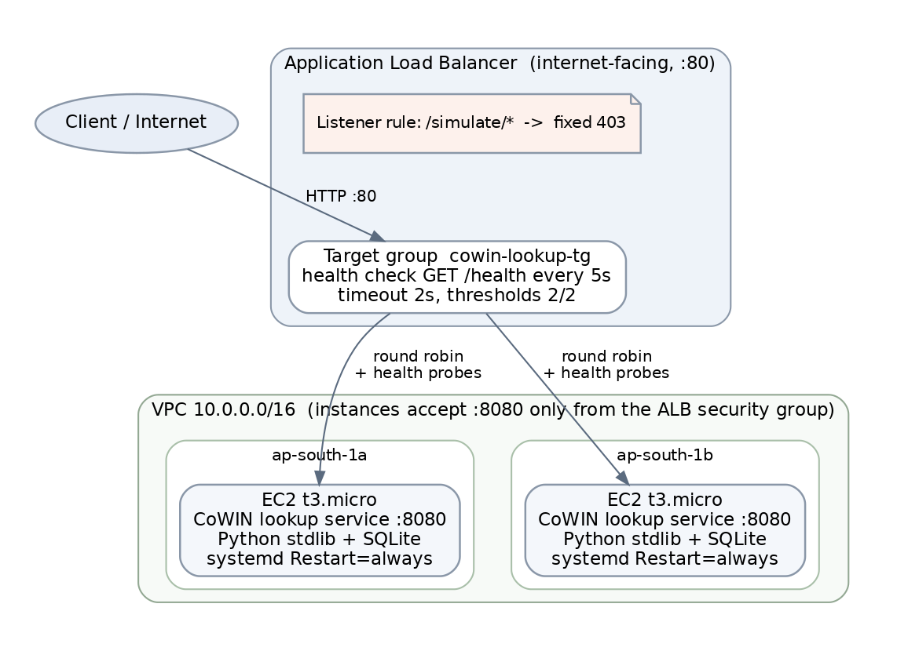
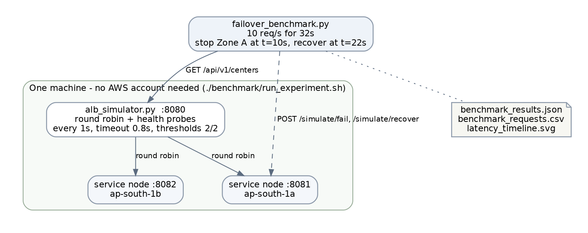
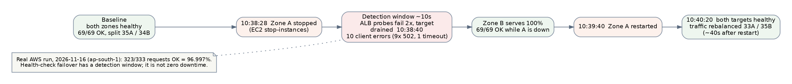

# CoWIN Two-Zone High-Availability Proof of Concept

A case study of the CoWIN vaccination platform's availability architecture, built for IT457 Cloud Computing. It reproduces the core availability pattern behind a national-scale public platform: stateless service nodes in two availability zones behind a load balancer with aggressive health checking.

The repository contains:

- a zero-dependency Python lookup service with a browser frontend
- a CloudFormation template and deploy script for a two-zone AWS deployment
- a local ALB simulator and failover benchmark that reproduce failover without an AWS account
- raw evidence from a real AWS failover run

## Contents

- [Architecture](#architecture)
- [Service](#service)
- [Quickstart](#quickstart)
- [AWS deployment](#aws-deployment)
- [Failover results](#failover-results)
- [Cost and scaling](#cost-and-scaling)
- [Repository layout](#repository-layout)
- [Team](#team)

## Architecture

The topology is defined in [`infrastructure/aws_cfn_cowin_two_zone.yaml`](infrastructure/aws_cfn_cowin_two_zone.yaml) and deploys to AWS Mumbai (`ap-south-1`).



```
                        Internet
                            |
                  Application Load Balancer
                  (internet-facing, port 80)
                  /simulate/* -> 403 at the edge
                            |
                Target Group: GET /health every 5s
                (timeout 2s, healthy/unhealthy thresholds 2/2)
                    |                       |
             ap-south-1a              ap-south-1b
             EC2 lookup service       EC2 lookup service
             :8080                    :8080
```

| Property | Design |
| --- | --- |
| Network isolation | Custom VPC (`10.0.0.0/16`) with one public subnet per zone. Instances accept port 8080 only from the load balancer's security group. |
| Health-gated routing | The target group removes a node after 2 consecutive failed probes and restores it after 2 successes. |
| Stateless nodes | Every node serves the same dataset, so failover and recovery lose no state. RPO is zero by construction. |
| Failure injection | `/simulate/fail` and `/simulate/recover` are protected by an API key and denied at the load balancer listener. Real drills stop and start the Zone A instance instead. |
| Self-healing | Each node runs the service under systemd with `Restart=always`. |

## Service

[`service/`](service/) is a Python 3 service that uses only the standard library, so it runs on a plain EC2 instance with no build step. Lookups run as SQL queries against SQLite, loaded from [`centers_data.json`](service/centers_data.json) on first start.

| Route | Description |
| --- | --- |
| `GET /health` | Readiness check used by the load balancer. Returns 200 only when the store is reachable and the dataset is loaded. |
| `GET /api/v1/centers` | Vaccination-centre lookup. Filter with `?district=` and `?pincode=`. |
| `GET /metrics` | Uptime, zone health, per-endpoint and per-status counters, store and rate-limit counters. |
| `GET /info` | Service information and endpoint directory. |
| `GET /ui/` | Responsive lookup frontend. |
| `/simulate/fail`, `/simulate/recover` | Force the health check to fail or recover. Requires `X-API-Key` when `COWIN_API_KEY` is set. |

Browsers that send `Accept: text/html` receive styled views of the API routes. All other clients receive JSON. Every response carries `X-Served-By-Zone` and `X-Instance-Id` headers, so traffic distribution across zones is directly observable.

Configuration is by environment variable or CLI flag: `PORT`, `AWS_AZ`, `AWS_INSTANCE_ID`, `CENTERS_DATA_FILE`, `CENTERS_DB_FILE`, `COWIN_API_KEY`, `RATE_LIMIT_RPS`, `RATE_LIMIT_BURST` and `LOG_LEVEL`. The full table is in [`service/README.md`](service/README.md).

The frontend and sample data are a course demo, not the official CoWIN portal. Dates and capacity values come from a static dataset and are not live availability.

## Quickstart

Requirements: Python 3, plus bash and curl for the local launcher. No packages are installed.

Run the service:

```bash
python3 service/app.py
# http://localhost:8080/ui/
```

Run the test suites (110 tests):

```bash
make test
```

Run the local failover experiment:

```bash
RUN_DIR=/tmp/cowin-demo ./benchmark/run_experiment.sh
python3 benchmark/generate_plots.py --run-dir /tmp/cowin-demo
```



The script starts two service nodes and a local ALB simulator, injects a zone failure mid-run, and records latency, zone distribution and failover transitions. Use a fresh `RUN_DIR` for each run. See [`benchmark/README.md`](benchmark/README.md) for the harness design and the manual AWS sampling workflow.

## AWS deployment

Requires the AWS CLI configured for `ap-south-1`.

```bash
./infrastructure/deploy_aws.sh deploy          # create the stack (about 4 min)
./infrastructure/deploy_aws.sh status          # target group health
./infrastructure/deploy_aws.sh fail-zone-a     # stop the Zone A instance
./infrastructure/deploy_aws.sh recover-zone-a  # start it again
./infrastructure/deploy_aws.sh destroy         # delete the stack
```

- Each node fetches the service artifact from this repository at the commit set by the `AppRepoRef` parameter. `deploy` pins it to the checked-out `HEAD`, so deploys are reproducible. A running stack does not pick up repository changes. Deploy a new stack to release a new version.
- The service is a package. Each node needs `app.py`, `pages.py`, `centers_data.json` and the whole `static/` directory.
- `COWIN_API_KEY` is required by the template (minimum 16 characters). `deploy` generates one if it is not set.
- After a deploy, `python3 service/verify_deployment.py --url "$ALB_URL"` samples the ALB and reports which zones answered. It performs read requests only.

## Failover results

### Local simulator

Reference run ([`benchmark/benchmark_results.json`](benchmark/benchmark_results.json)): 32 seconds at 10 requests/second, zone failure injected at t=10s.

| Metric | Value |
| --- | --- |
| Requests | 320 / 320 successful |
| Failover detection and traffic shift | 2.3 s |
| Client-visible disruption | 0.0 s |
| Recovered node back in rotation | about 2 s after recovery |
| Latency p50 / p99 | 2.28 ms / 3.33 ms |

The simulator uses the template's threshold semantics (2 failures to remove, 2 successes to restore) but probes every 1 s with a 0.8 s timeout, against 5 s and 2 s on AWS. These numbers characterize the failover logic, not AWS network behavior.

### AWS run, 2026-11-16

The Zone A instance was stopped at 10:38:28 IST and restarted at 10:39:40 IST behind the real ALB. Raw samples, the AWS-side timeline and a summary PDF are in [`evidence/aws-run-2026-11-16/`](evidence/aws-run-2026-11-16/).



| Phase | Requests | Successful | Errors |
| --- | ---: | ---: | ---: |
| Baseline | 69 | 69 | 0 |
| Zone A stopping | 38 | 28 | 10 |
| Zone A stopped | 69 | 69 | 0 |
| Zone A starting | 89 | 89 | 0 |
| Both zones healthy | 68 | 68 | 0 |
| **Total** | **333** | **323** | **10** |

- 96.997% of requests succeeded. The 10 errors (9 HTTP 502, 1 client timeout) fall in a window of about 10 s while the ALB detected and drained the stopped target.
- While Zone A was down, Zone B served 100% of traffic.
- Both targets were healthy again about 40 s after the restart.

This is not zero downtime. Health-check-based failover has a detection window, and the data shows it.

## Cost and scaling

Full analysis: [`docs/week-3/COST_AND_SCALING_ANALYSIS.md`](docs/week-3/COST_AND_SCALING_ANALYSIS.md).

| Scenario | Estimate |
| --- | --- |
| Two-zone PoC, 8-hour demo | $0.00 on the AWS Free Tier; about $0.61 at commercial rates ($0.054/hour) |
| National-scale, multi-region active-active on AWS | about $45,800/month |
| National-scale on sovereign cloud (NIC MeghRaj) | about 33.5 lakh INR/month |

A full month of always-on PoC runtime exceeds the account-wide free-tier allowances.

## Repository layout

```
infrastructure/   CloudFormation template and deploy/failover automation
service/          Lookup service, frontend, dataset, systemd unit, tests
benchmark/        ALB simulator, failover benchmark, plots, tests
evidence/         Raw data from the AWS failover run
docs/             Weekly reports, cost analysis, screenshots, team work division
```

Weekly documents: [`week-1`](docs/week-1/), [`week-2`](docs/week-2/), [`week-3`](docs/week-3/).

## Team

| Member | Student ID | Domain |
| --- | --- | --- |
| Jeetrajsinh Gohil ([@jeetrex17](https://github.com/jeetrex17)) | 202303017 | Backend, frontend, test tooling |
| Kaushal Nandaniya ([@kaushalnandaniya](https://github.com/kaushalnandaniya)) | 202303036 | Backend observability, architecture, reports, cost and scaling |
| Darshil Gandhi ([@darshil-2005](https://github.com/darshil-2005)) | 202301056 | AWS infrastructure, deployment, benchmarking, evidence |

Details in [`docs/team/TEAM_WORK_DIVISION.md`](docs/team/TEAM_WORK_DIVISION.md).
